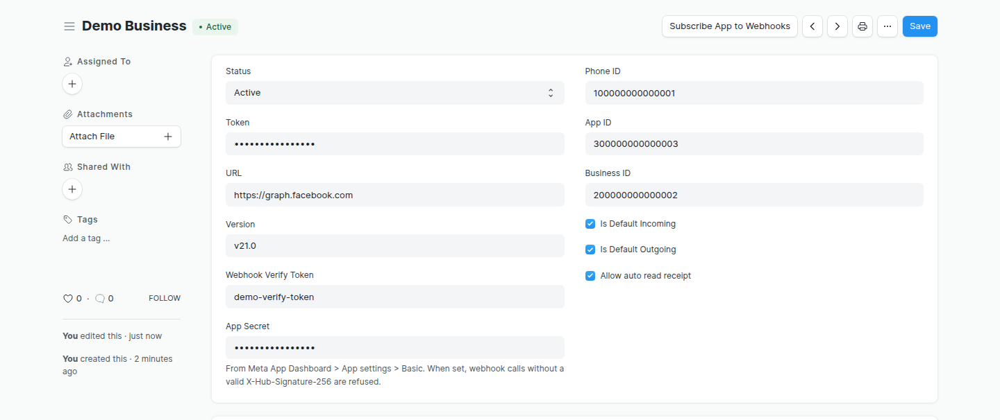
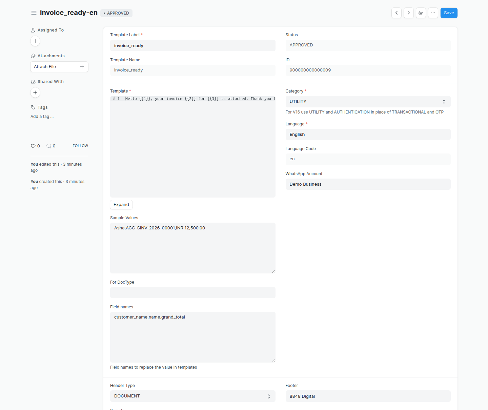
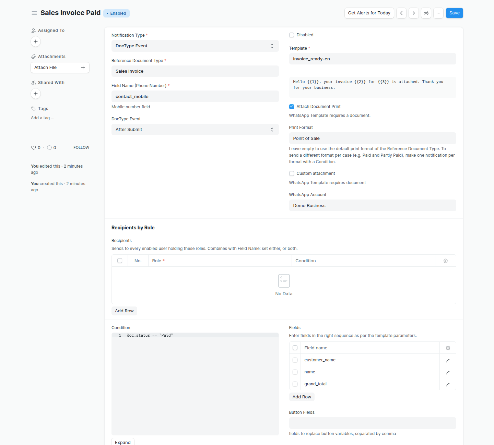
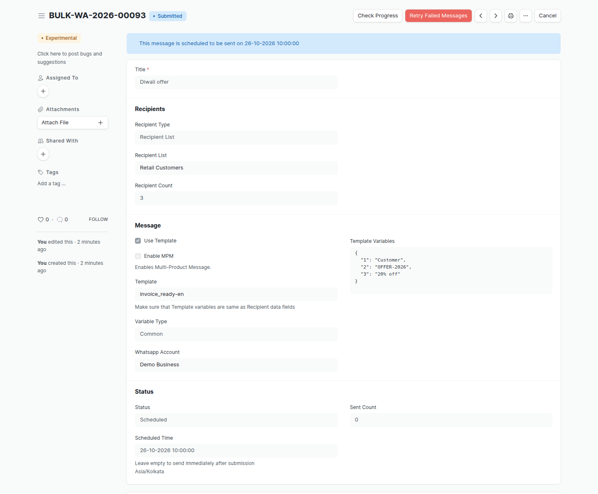
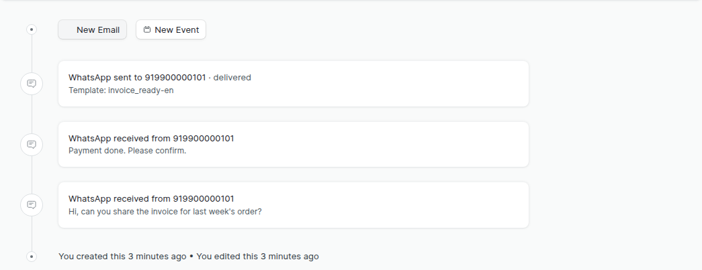

<!--
Copyright (c) 2026 8848 Digital LLP. All rights reserved.
Proprietary and confidential. Unauthorized copying, distribution, or use
of this file, via any medium, is strictly prohibited without prior
written permission from 8848 Digital LLP.
-->

# Frappe Whatsapp

Send and receive WhatsApp messages from Frappe and ERPNext through the
Meta WhatsApp Cloud API. You do not need a third-party gateway.

| | |
| --- | --- |
| **Frappe versions** | 14, 15 and 16 |
| **Python package** | `frappe_whatsapp` |
| **Module** | Frappe Whatsapp |
| **License** | Proprietary, 8848 Digital LLP |

## Contents

1. [What the app does](#what-the-app-does)
2. [Install](#install)
3. [Step 1: Connect a WhatsApp account](#step-1-connect-a-whatsapp-account)
4. [Step 2: Set the webhook in Meta](#step-2-set-the-webhook-in-meta)
5. [Step 3: Add templates](#step-3-add-templates)
6. [Step 4: Send messages automatically (notifications)](#step-4-send-messages-automatically-notifications)
7. [Step 5: Send a campaign (bulk messages)](#step-5-send-a-campaign-bulk-messages)
8. [See the chat on the document (timeline)](#see-the-chat-on-the-document-timeline)
9. [Send a template from code](#send-a-template-from-code)
10. [Development](#development)

## What the app does

| Feature | What you get |
| ------- | ------------ |
| **Accounts** | Connect one or more WhatsApp Business accounts. Set a default account for incoming and for outgoing messages. |
| **Messages** | Send and receive text, images, documents, video, audio, reactions, buttons, lists and WhatsApp Flows. |
| **Templates** | Create templates, send them to Meta for approval, and sync them from Meta. |
| **Notifications** | Send a template when a document is saved, submitted, cancelled and so on, or on a schedule. Attach a PDF of the document or a file. |
| **Bulk messages** | Send a template to a list of numbers, now or at a set time. See the progress and retry failed messages. |
| **Timeline** | See the WhatsApp messages of a document in its timeline. |
| **Webhook** | Receive messages, delivery status and template status from Meta. Only requests signed by Meta are accepted. |

## Install

```bash
bench get-app https://github.com/8848digital/frappe_whatsapp
bench --site <site> install-app frappe_whatsapp
bench --site <site> migrate
```

Before you start, create a Meta app with the WhatsApp product. See
[Get started](https://developers.facebook.com/docs/whatsapp/cloud-api/get-started)
in the Meta documentation. You need these values from the Meta App
Dashboard:

| Value | Where to find it in Meta |
| ----- | ------------------------ |
| Access token | WhatsApp > API Setup (use a permanent system user token for production) |
| Phone number ID | WhatsApp > API Setup |
| WhatsApp Business Account ID | WhatsApp > API Setup |
| App ID and App Secret | App settings > Basic |

## Step 1: Connect a WhatsApp account

1. Go to **WhatsApp Account** and click **Add WhatsApp Account**.
2. Enter the values from the table above. Set **URL** to
   `https://graph.facebook.com` and **Version** to the Graph API version,
   for example `v21.0`.
3. In **Webhook Verify Token**, type any secret text. You use the same
   text in Meta in step 2.
4. Enter the **App Secret**. The app uses it to check that webhook calls
   come from Meta.
5. Select **Is Default Incoming** and **Is Default Outgoing** if this is
   your main account.
6. Save, then click **Subscribe App to Webhooks**.



## Step 2: Set the webhook in Meta

In the Meta App Dashboard, go to **WhatsApp > Configuration** and edit the
webhook:

| Meta field | Value |
| ---------- | ----- |
| Callback URL | `https://<your-site>/api/method/frappe_whatsapp.utils.webhook.webhook` |
| Verify token | The **Webhook Verify Token** from step 1 |
| Webhook fields | Subscribe to `messages` and `message_template_status_update` |

Meta signs each webhook call with your App Secret. When an active
WhatsApp Account has an App Secret, the app refuses calls without a valid
signature (HTTP 403) and saves nothing.

> **Note:** If no account has an App Secret, the app accepts the calls and
> logs a warning. To refuse unsigned calls in all cases, run
> `bench --site <site> set-config whatsapp_require_signed_webhooks 1`.

## Step 3: Add templates

To start a conversation, WhatsApp requires a template that Meta has
approved. You can send free text only within 24 hours of the customer's
last message.

- **To get existing templates:** go to **WhatsApp Templates** and click
  **Sync from Meta**.
- **To make a new template:** click **Add WhatsApp Templates**. Write the
  text with `{{1}}`, `{{2}}` for the variable parts, give sample values,
  and save. The template goes to Meta for approval. The status changes
  to **APPROVED** when Meta approves it.

In **Field names**, you can enter the document fields that fill
`{{1}}`, `{{2}}` and so on, in order. Set **Header Type** to `DOCUMENT`,
`IMAGE` or `VIDEO` to send a file with the message.



## Step 4: Send messages automatically (notifications)

A **WhatsApp Notification** sends a template when something happens to a
document. The example below sends the invoice PDF to the customer when a
Sales Invoice is submitted and paid.

1. Go to **WhatsApp Notification** and click **Add WhatsApp Notification**.
2. Set **Notification Type**:
   - **DocType Event**: send when a document is inserted, saved,
     submitted, cancelled or deleted, or a number of days before or after
     a date in the document.
   - **Scheduler Event**: send hourly, daily, weekly or monthly.
3. Set **Reference Document Type** (for example Sales Invoice) and the
   **DocType Event** (for example After Submit).
4. Select the **Template**. The template text shows below it.
5. Choose who gets the message:
   - **Field Name (Phone Number)**: a field of the document that holds the
     mobile number, for example `contact_mobile`.
   - **Recipients by Role**: every user with that role. You can use both.
6. In **Fields**, add the document fields for `{{1}}`, `{{2}}` and so on, in
   order.
7. Optional: add a **Condition** in Python, for example
   `doc.status == "Paid"`. The message is sent only when it is true.
8. Optional: attach a file (see below). Then save.



### Attach a PDF of the document

Select **Attach Document Print**. In **Print Format**, select the format
to send. If you leave it empty, the default print format of the doctype
is used.

To send a different print format for different cases, make one
notification for each case. For example, one notification with the
condition `doc.status == "Paid"` and a "Paid" format, and one with
`doc.status == "Partly Paid"` and a "Partly Paid" format.

### Attach a file

Select **Custom attachment**, then do one of these:

- Attach a file in **Attach** to send the same file every time.
- Enter an Attach field of the document in **Attach from field** to send
  the file of that document.

The app uploads the file to Meta and sends it as a media ID. Private
files, and sites that Meta cannot reach (for example a local or VPN
server), work too.

## Step 5: Send a campaign (bulk messages)

1. Optional: go to **WhatsApp Recipient List** and make a list. You can
   add numbers by hand or import them from any doctype, for example
   Customer or Contact.
2. Go to **Bulk WhatsApp Message** and click **Add Bulk WhatsApp Message**.
3. Enter a **Title**. Set **Recipient Type** to **Individual** (add
   numbers in the table) or **Recipient List** (select a list).
4. Select **Use Template** and the **Template**. Set **Variable Type**:
   - **Common**: the same values for all recipients. Enter them in
     **Template Variables**.
   - **Unique**: the values come from the data of each recipient.
5. Optional: set **Scheduled Time** to send later.
6. Submit.

Without a scheduled time, the messages are sent at once in the
background. With a scheduled time, the status is **Scheduled** until that
time. Click **Check Progress** to see how many are sent, and **Retry
Failed Messages** to send the failed ones again.



## See the chat on the document (timeline)

Each WhatsApp Message that is linked to a document shows in the timeline
of that document. You can see the sent and received messages, the
number, the delivery status and the text, together with emails and
comments. Click a card to open the message.

Messages sent by a notification are linked to their document
automatically. Users see the cards only if they can read WhatsApp
Message.



## Send a template from code

In a **Scheduler Event** notification, the condition can choose the
documents and numbers to send to:

```python
invoices = frappe.get_list(
    "Sales Invoice",
    filters={"status": "Overdue"},
    fields=["name", "contact_mobile"],
)
doc.set("_data_list", [
    {"name": inv.name, "phone_no": inv.contact_mobile} for inv in invoices
])
```

To send a template without document fields, set `_contact_list`
instead, for example `doc.set("_contact_list", ["919900000000"])`.

## Development

The app follows the 8848 custom app setup
([custom_app_setup.md](https://github.com/8848digital/skills/blob/8848-skills/project_base_template/custom_app_setup.md)).

### Set up pre-commit

Do this once in each clone, with the bench environment active:

```bash
cd apps/frappe_whatsapp
pip install pre-commit
pre-commit install
```

Each commit then runs these checks on the changed files:

| Check | Configuration |
| ----- | ------------- |
| black, isort, ruff settings | `pyproject.toml` |
| flake8 | `.flake8` |
| eslint, prettier | `.eslintrc` |
| Maximum 250 lines in a Python file | `scripts/check_max_lines.py` |
| No direct commits to `master` or `develop` | `.pre-commit-config.yaml` |

To check all files, run `pre-commit run --all-files`.

> **Note:** Some existing files are longer than 250 lines. If you change
> one of them, split it or move code out before you commit.

### Commit messages

Use conventional commits, for example `feat: ...`, `fix: ...` or
`chore: ...`. The allowed types are in `commitlint.config.js`. The
**Linters** workflow checks the commit messages of each pull request. It
also runs the Frappe Semgrep rules and `pip-audit`.

### Agent skills

`.claude/skills/` and `CLAUDE.md` come from
[8848digital/skills](https://github.com/8848digital/skills). Do not edit
them in this repo. To get the latest version, run:

```bash
scripts/sync_skills.sh
```

The script also updates `frappe_whatsapp/commands/` and
`frappe_whatsapp/utils/api_handlers/`. Do not add code to those
template files, because the script overwrites them.

### Bench commands

```bash
bench --site <site> 8848-export-fixtures --app frappe_whatsapp
```

This command exports the Custom Fields of the Frappe Whatsapp module
(the `custom_fixtures` hook).

### CodeGraph

To build the local code index, run `codegraph install` in the app folder.
The `.codegraph/` folder is in `.gitignore`.

### Tests

```bash
bench --site <test-site> set-config allow_tests true
bench --site <test-site> run-tests --app frappe_whatsapp
```

## License

Proprietary — Copyright (c) 2026 8848 Digital LLP. All rights reserved.
See [license.txt](license.txt) for details, including the third-party
notice.
